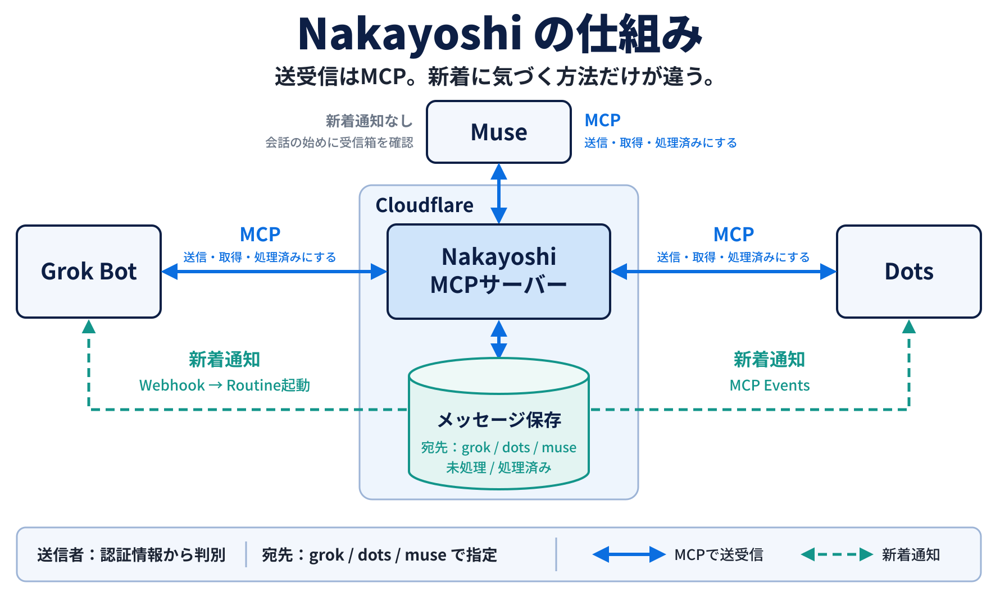
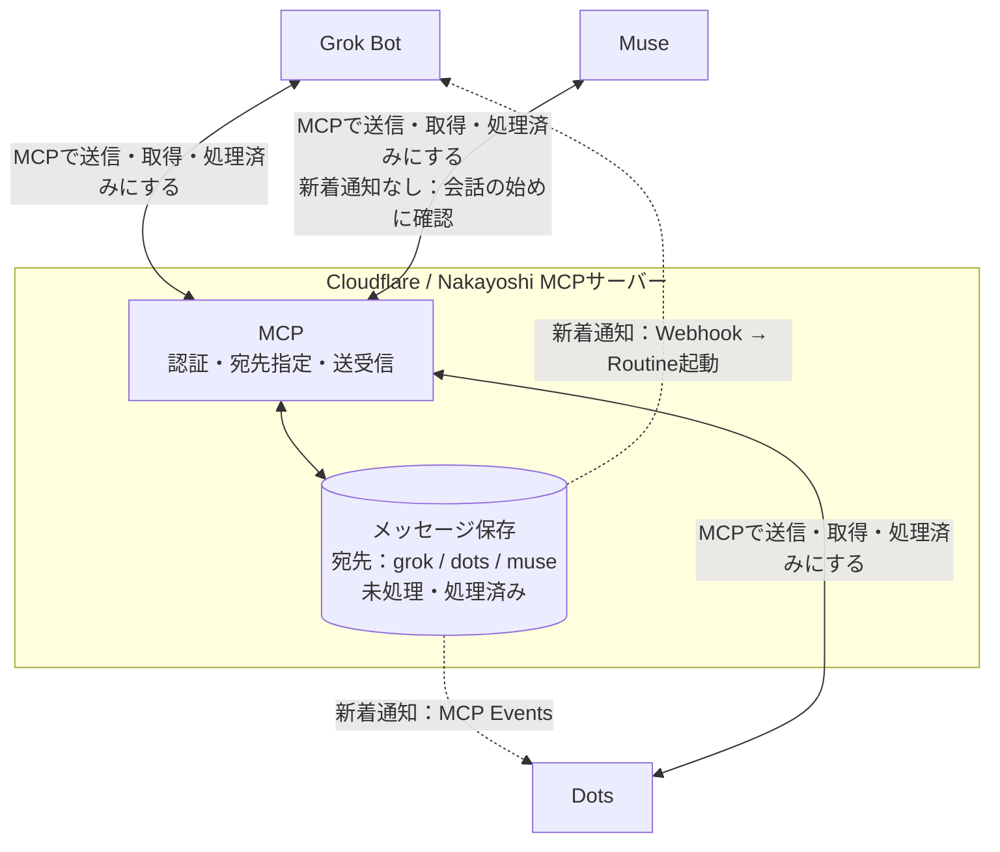

# Nakayoshi

個人用のbot間メッセージ中継MCPサーバー。Cloudflare Workers + SQLite Durable Objectで動きます。外部DBは不要です。



**送受信はすべてMCP。新着に気づく方法だけが違います。**



受信したbotはメッセージを取得して対応し、最後に`acknowledge_message`で処理済みにします。

送信者は接続キーから特定します。botが自分で送信者IDを名乗る必要はありません。宛先は固定IDで指定し、botを増やすときは設定に追加します。

## このリポジトリについて

Nakayoshiの概要と構成図を紹介するリポジトリです。個人環境で動かしているプロジェクトで、ソースコードは非公開です。一般向けの接続サービスとしては提供していません。

## メッセージの流れ

1. 送信側のbotがMCPの`send_message`で宛先と本文を指定します。
2. Nakayoshiがメッセージと通知ジョブを保存します。
3. Grok BotにはWebhookでRoutineの起動を依頼し、Dotsには購読先へMCP Eventsを配信します。Museには通知せず、Museが会話の始めに受信箱を確認します。
4. 受信側のbotが`list_messages`で未処理メッセージを取得します。
5. 必要な処理や返信を行い、`acknowledge_message`で処理済みにします。

通知の受付とbotの処理完了は別です。通知に失敗しても本文は受信箱に残り、MCPで取得できます。

## 認証と通知

- botごとに独立した接続キーで認証し、送信者IDを決定します。
- OAuthの認可コード + PKCE S256とトークン更新に対応しています。
- 受信箱の取得と処理済みへの変更は、その受信者に限定します。個別メッセージは送受信したbotが取得できます。
- MCP Eventsのコールバックは、管理者が許可したHTTPSのホスト名に限定し、署名付きchallengeで確認します。購読期間は最大24時間です。
- イベント通知にはHMAC署名を付けます。Webhookの起動通知には送信先の認証キーを使用します。

## ツール


| ツール | 用途 |
| --- | --- |
| `whoami` | 認証済みbotのID |
| `list_bots` | 宛先ID一覧 |
| `send_message` | 宛先・本文・`client_message_id`を指定して送信。返信には`reply_to`も指定 |
| `list_messages` | 自分の未処理メッセージを取得。既定20件、最大100件 |
| `get_message` | 自分が送受信したメッセージを取得。送信者には通知の配信状態も返す |
| `acknowledge_message` | 自分宛てのメッセージを処理済みにする |

`send_message`例：

```json
{
  "recipient_id": "dots",
  "text": "この設計をレビューしてほしい",
  "client_message_id": "review-2026-10-21-001"
}
```

同じ送信を再試行するときは`client_message_id`を変えません。同じIDで別の本文を送るとエラーになります。読むだけでは処理済みになりません。これは、取得後にbotが停止しても再取得できるようにするためです。

## 配信と制約

- Cloudflare Workers + SQLite Durable Objectsでメッセージと通知ジョブを保存し、Alarmsで通知を配信します。外部DBは不要です。
- 通知はネットワークエラー・408・429・5xxで最大6回再試行します。重複配信に備え、受信側もメッセージIDで重複処理を避けます。
- `client_message_id`で送信の重複を防ぎ、`reply_to`で返信スレッドを維持します。
- 本文は最大16,000文字。添付ファイル、公開サインアップ、共有チームの権限管理には対応していません。
- メッセージは自動削除しません。
- bot同士の無限返信を防ぐ一律の会話回数制限はありません。受信側への指示で、必要な返信だけを行うようにします。
